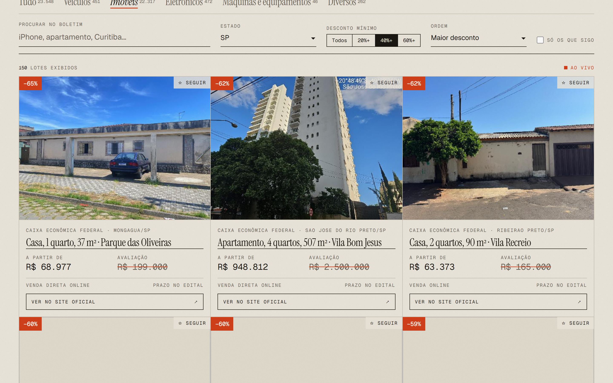
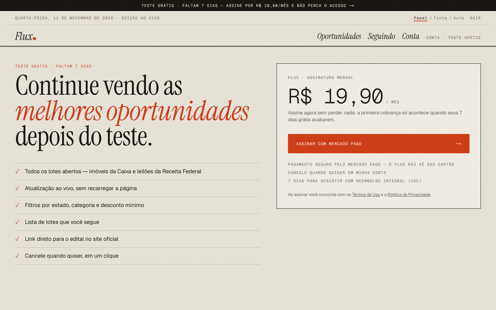
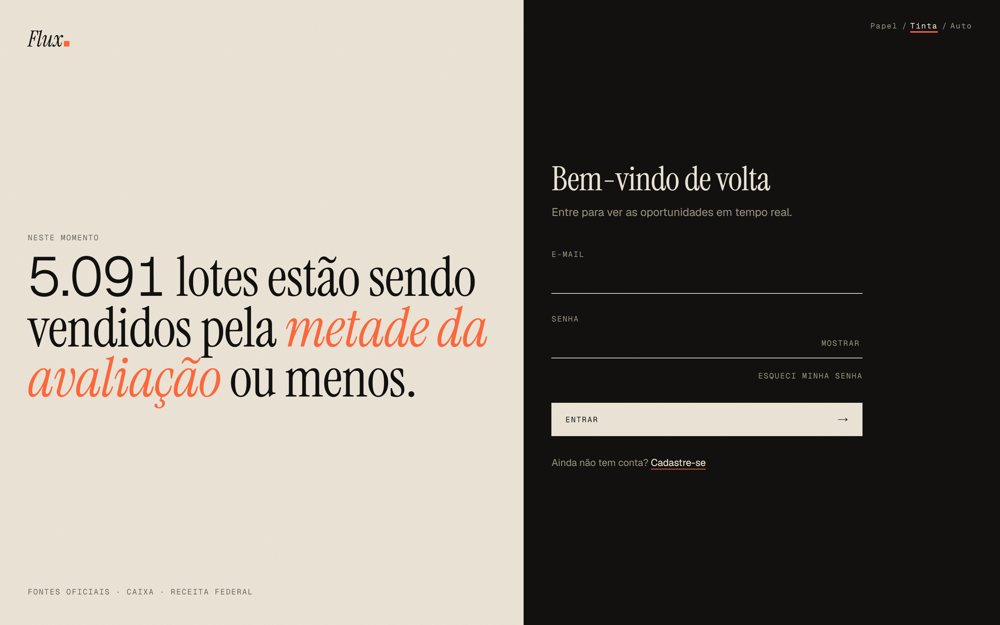
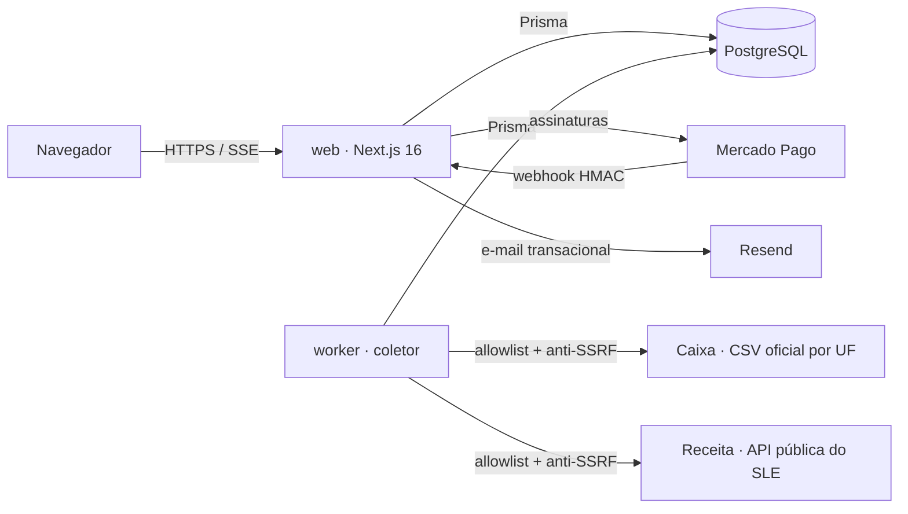

# Flux.

### Boletim de leilões oficiais do Brasil, ao vivo

**[fluxleiloes.com.br](https://fluxleiloes.com.br)** — SaaS em produção, com assinatura recorrente

> 🔒 Este repositório é a **vitrine** do projeto. O código-fonte é privado por ser um produto comercial — disponível para avaliação técnica mediante solicitação.

---

## O problema

Leilões oficiais no Brasil são uma das melhores formas de comprar imóveis, carros e eletrônicos abaixo do preço — mas a informação está espalhada em listas CSV, PDFs de editais e portais diferentes, sem nenhuma forma de comparar oportunidades.

## A solução

O **Flux** coleta continuamente as fontes **oficiais e públicas**, normaliza tudo, calcula **quanto cada lote está abaixo da avaliação** e entrega um painel ao vivo, com link direto para o edital no site do órgão.

| | |
|---|---|
| **23 mil+ lotes ativos** | 22 mil imóveis da Caixa + 1.200 lotes da Receita Federal |
| **Tempo real** | Lotes novos e alterados aparecem sem recarregar a página |
| **Assinatura** | 7 dias grátis, depois R$ 19,90/mês via Mercado Pago |
| **Fontes** | Somente dados públicos e oficiais — nada de scraping de sites privados |

## Telas

<table>
  <tr>
    <td width="50%"></td>
    <td width="50%"></td>
  </tr>
  <tr>
    <td align="center">Painel ao vivo — tema <b>Tinta</b></td>
    <td align="center">Imóveis em SP com 40%+ de desconto — tema <b>Papel</b></td>
  </tr>
  <tr>
    <td></td>
    <td></td>
  </tr>
  <tr>
    <td align="center">Capa com manchete automática</td>
    <td align="center">Assinatura (Mercado Pago)</td>
  </tr>
</table>

  
  &nbsp;
  
  &nbsp;
  

## Design

A identidade foi pensada para **não parecer template**: um *boletim impresso de leilões*.
Papel e tinta, filetes finos no lugar de cards arredondados, títulos em serifa (Instrument Serif), números em fonte mono como em pregão, e uma única cor de sinal — o vermelhão das plaquinhas de lance. A **manchete da capa é gerada todo dia** a partir da melhor oportunidade real, e uma faixa de cotações corre no topo.

## Arquitetura

- **web** e **worker** usam a **mesma imagem Docker** e rodam como serviços separados no Railway.
- O tempo real usa **Server-Sent Events** lendo mudanças do banco por `updatedAt` — funciona com o coletor em outro processo, sem broker.
- O schema Prisma é mantido em SQLite para desenvolvimento e **convertido para PostgreSQL no build** do Docker.

## Desafios técnicos resolvidos

**Coleta confiável de fontes heterogêneas** — a Caixa publica 27 CSVs em Latin-1; a Receita expõe uma API JSON cujo detalhe de cada lote exige uma chamada extra. O coletor usa conectores com um contrato único, valida cada campo com **zod**, busca detalhes **só de lotes novos** (de 7 min para 9 s nas coletas seguintes) e marca como encerrado o que sumiu do catálogo.

**Tempo real sem eventos falsos** — o ingest só grava linhas que **realmente mudaram**, então o SSE não inunda o navegador. O cliente aplica os mesmos filtros do servidor (função compartilhada) a cada evento.

**Um bug sutil de validação** — `z.coerce.date()` transformava `null` em **1º de janeiro de 1970**, e 22 mil imóveis foram marcados como encerrados. Corrigido trocando a ordem da união e coberto por teste de regressão.

**Cobrança que não vaza dinheiro nem acesso** — o estado da assinatura é **sempre relido na API do Mercado Pago** (nunca confiando no corpo do webhook ou na URL de retorno), webhooks são verificados por **HMAC com comparação em tempo constante**, cada usuário tem no máximo **uma** cobrança recorrente (duplicatas são canceladas), excluir a conta cancela a cobrança antes, e cartão recusando não vira acesso gratuito.

**LGPD nos dados de terceiros** — placas, chassi, Renavam, IMEI e números de série são removidos dos títulos antes de gravar.

## Segurança

O projeto foi construído com um "time" de revisão de segurança (AppSec, modelagem de ameaças STRIDE, infraestrutura e LGPD), e **cada revisão gerou correções reais**:

- Senhas com **Argon2id** (parâmetros OWASP) e verificação em tempo constante contra enumeração de contas
- Sessões opacas (só o SHA-256 do token no banco), revogáveis, cookies `HttpOnly` + `Secure` + `SameSite`
- **Rate limit em camadas** (par e-mail+IP, e-mail, IP) com registro *antes* da verificação — sem condição de corrida — e IP lido de forma não forjável atrás do proxy
- **CSP com nonce** por requisição + `strict-dynamic`, HSTS, `frame-ancestors 'none'`
- Coletor com **anti-SSRF**: allowlist de hosts (inclusive em redirects), bloqueio de IPs internos via DNS, portas 80/443, limite de tamanho e timeout
- Recuperação de senha com token de uso único, 30 min, resposta idêntica exista ou não a conta, e link sempre montado a partir do domínio configurado (nunca do cabeçalho `Host`)
- CI com auditoria de dependências e lista de exceções **documentadas**; Dependabot semanal

## Stack

| Camada | Tecnologia |
|---|---|
| Front-end | Next.js 16 (App Router, Server Components, Server Actions), React 19, Tailwind CSS v4 |
| Back-end | Route Handlers, SSE, Prisma ORM, zod |
| Dados | PostgreSQL (produção), SQLite (desenvolvimento) |
| Pagamentos / e-mail | Mercado Pago (Preapproval + webhooks), Resend |
| Infra | Docker, Railway (web + worker + Postgres), Cloudflare DNS |
| Qualidade | TypeScript estrito, Vitest (70 testes), GitHub Actions, Dependabot |

## Números

- **23.548** lotes abertos no momento da captura destas telas
- **70** testes automatizados (segurança, cobrança, normalização das fontes, domínio)
- **2** fontes oficiais, coletadas a cada 1 h (Receita) e 6 h (Caixa)
- **0** dados de cartão tocados pelo Flux — o checkout é do Mercado Pago

---

<b>🇺🇸 English summary</b>

**Flux** is a production SaaS that aggregates **official, public Brazilian auction listings** (22k+ federal bank real-estate lots and 1.2k+ federal revenue seizure lots — vehicles, electronics, machinery), computes each lot's discount versus its appraisal value, and streams updates live to subscribers.

**Highlights:** Next.js 16 / React 19 / TypeScript (strict) / Prisma + PostgreSQL / Tailwind v4 · Server-Sent Events across processes (worker ↔ web through the DB) · Dockerized web + worker on Railway · recurring billing with Mercado Pago (HMAC-verified webhooks, state always re-fetched from the provider, duplicate-subscription and chargeback handling) · security-first: Argon2id, opaque revocable sessions, layered race-free rate limiting, nonce-based CSP, SSRF-hardened collector, LGPD-aware data scrubbing · 70 tests, CI, Dependabot.

Source code is private (commercial product) — available for technical review on request.

© Flux. Todos os direitos reservados. O Flux não é leiloeiro — os dados vêm de fontes oficiais e o edital no site do órgão é sempre a referência.
